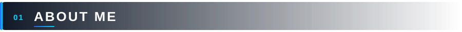
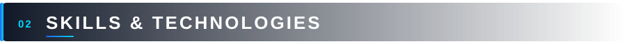
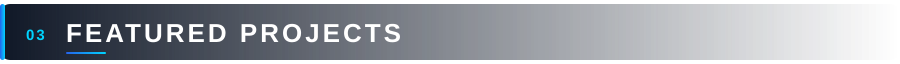
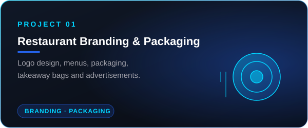
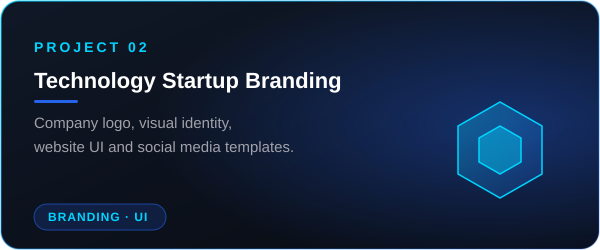
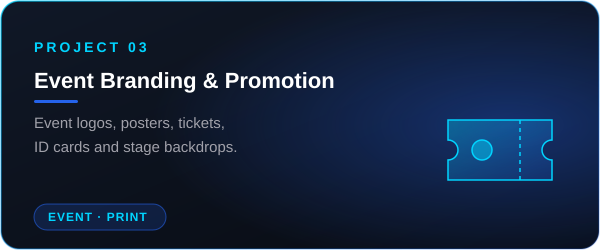
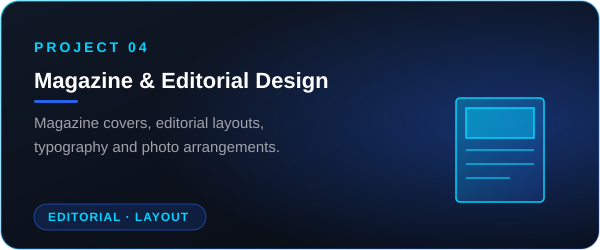
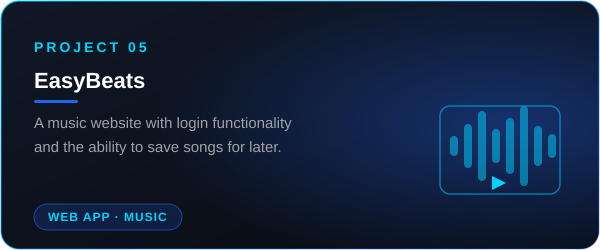
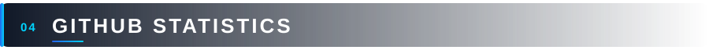

 

Hi, I'm **Mohamed Imthath** – a final-year **Bachelor of Applied Information Technology (BAIT)** student from Trincomalee, Sri Lanka, working at the meeting point of **design and technology**.

- 🎨 I design **brand identities, logos and print/digital graphics** that give businesses a clear visual voice.
- 🧩 I'm drawn to **UI/UX design** – turning ideas into clean, usable interfaces.
- 💻 I'm growing as a **software developer**, building web projects and learning new technologies.
- 🍔 I've created **promotional materials for Kebino and Genie Food Delivery**.
- 🚀 I love learning new tools and using them to build creative solutions.

### Graphic Design

### UI/UX & Creative Tools

### Programming

### Database

### 🌱 Currently Learning

<table align="center">
<tr>
<td width="50%"></td>
<td width="50%"></td>
</tr>
<tr>
<td width="50%"></td>
<td width="50%"></td>
</tr>
<tr>
<td width="50%"></td>
<td width="50%" align="center"> <b>See the full design work</b>  </td>
</tr>
</table>

I'm open to design projects, collaborations and software opportunities.

  

**Designing with creativity. Building with technology. Learning without limits.**

