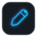

 

## 01 · About Me

> **Designing Visual Stories. Building Digital Experiences.**

I'm **Mohamed Imthath**, a graphic designer from Trincomalee, Sri Lanka, passionate about visual communication. I enjoy brand identity and UI/UX design, and I care about how a message looks, feels and works.

I'm currently studying for a **Bachelor of Applied Information Technology (BAIT)**, and I'm growing my interest in programming and software development alongside my design practice.

I've created promotional designs for **Kebino** and **Genie Food Delivery**. I'm driven by creativity, technology and continuous learning.

## 02 · What I Do

<table>
  <tr>
    <td width="50%"></td>
    <td width="50%"></td>
  </tr>
  <tr>
    <td width="50%"></td>
    <td width="50%"></td>
  </tr>
  <tr>
    <td width="50%"></td>
    <td width="50%"></td>
  </tr>
</table>

## 03 · My Creative Arsenal

###  Tools I Use

**Graphic Design** 

**UI/UX & Creative Tools** 

###  Technologies I'm Learning

**Programming** 

**Database** 

## 04 · Featured Projects

<table>
  <tr>
    <td width="50%"></td>
    <td width="50%"></td>
  </tr>
  <tr>
    <td width="50%"></td>
    <td width="50%"></td>
  </tr>
  <tr>
    <td colspan="2"></td>
  </tr>
</table>

More of my design work is on my portfolio: **[ericimt.netlify.app](https://ericimt.netlify.app)**

## 05 · GitHub Dashboard

## 06 · Development Journey

My path so far, from visual design toward building digital products:

> ◆ **Graphic Design** — where it started: visual communication and composition.
>
> ◆ **Brand Identity** — shaping logos, colour and typography into a coherent brand.
>
> ◆ **UI/UX Design** — designing interfaces that look good and feel intuitive.
>
> ◆ **Programming** — learning Python, Java, C++, PHP and the web stack.
>
> ◆ **Software Development** — building projects such as EasyBeats, a music website.
>
> ◆ **Creative Technology** — bringing design and code together *(ongoing)*.

## 07 · Connect With Me

### *Great design captures attention. Great technology creates possibilities. I love bringing both together.*

© Mohamed Imthath · Trincomalee, Sri Lanka

